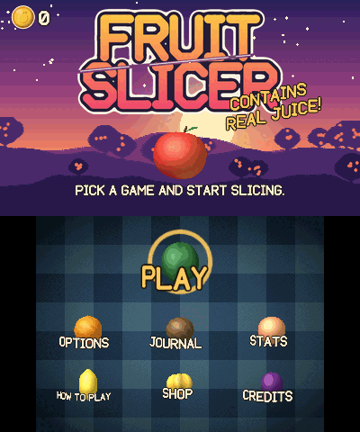
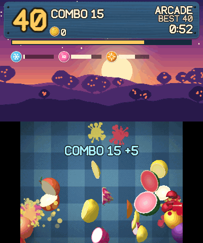
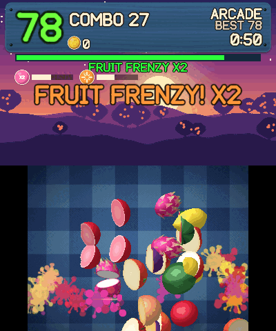
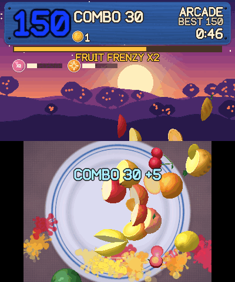

# Fruit Slicer 3DS

A free, fan-made fruit-slicing arcade game for the Nintendo 3DS. Swipe the touch screen to cut fruit out of the air, chain combos and stay away from the bombs.

**Version 1.0.0.** Tested on a real New 2DS XL and in the Azahar emulator. Old 3DS hardware and the look of stereoscopic 3D are still unconfirmed, so reports are welcome.

<p>
  
  
  
  
  
  
  
</p>

## Modes

| Mode | Rules |
| --- | --- |
| Classic | Three missed fruit and you're out. A bomb ends the run. |
| Arcade | 60 seconds. Bombs cost 10 points, your combo and half the Frenzy meter. Slice power-ups: Frost slows time, X2 doubles points, Fruit Storm throws fruit in from the sides. Ends on the Sunburst Fruit. |
| Zen | 90 calm seconds with no bombs and no misses. |
| Frenzy | 30 seconds of nonstop fruit. Bombs take 5 seconds off the clock, and a Fruit Frenzy throws fruit even faster. A bomb in the last 5 seconds brings the Sunburst Fruit straight away. |
| Sudden Death | One miss or one bomb ends the run. Fruit is worth double. |
| Minefield | Bombs take over as the run goes on. Missed fruit is free, and one bomb ends the run. |
| Combo Rush | 45 seconds of big fruit patterns. Swipe bonuses are doubled and bombs cost 10 points, your combo and half the Frenzy meter. Ends on the Sunburst Fruit. |
| Daily Fruit | 60 seconds, the same run for everyone that day, on every platform. A calendar keeps your daily scores and streak, and each day's first run pays a coin bonus. |
| Beat Slice | 60 seconds to music. Fruit is thrown as usual, but only slices on the beat score, and a streak of them scores more. The board's edges glow when a slice will count. Pick any track you own from the track list. |

**Practice:** the first Play starts a short, skippable lesson run. How to Play replays it.

**Scoring:** 1 point per fruit, 3 for a coconut and 5 for a rare golden star fruit. The COMBO count rises with every fruit, and each 15 adds a 5-point bonus. A bomb or an empty Frenzy meter resets it. A missed fruit does not.

**Swipe combos:** slicing 3 or more fruit in one stroke earns a bonus, and each tier has its own sound and effects: Nice (3), Great (4), Awesome (5), Super (6), Insane (8) and Legendary (10). The bonus is the number sliced, multiplied by 2 from Awesome, 3 at Insane and 4 at Legendary.

**Fruit Frenzy:** slicing fills the meter on the top screen. It drains all the time, so keep slicing to push it up. Easy drains it slowly and each slice adds more; Hard and Insane drain it faster and each slice adds less. If it runs dry, your COMBO resets. Fill it for 7 seconds of double points and a shower of fruit. Bombs already on their way fizzle out, and fruit from the shower can't count as a miss.

**Sunburst Fruit:** when the clock runs out in a mode that has it, one giant fruit rises and hangs in the air for 4 seconds. Scrub the stylus across it as fast as you can. Each 70 pixels of blade travel inside it is a hit worth 1 point, every 10th hit adds 5, and it bursts at the end for 2 points per hit.

**Coconuts** take two hits. The first one cracks the shell and knocks it back up.

**Fruit patterns:** rows, fountains, crossfire and staircases are thrown only when no bomb is in play. Normal throws try several paths and keep the one that stays furthest from any bomb, so fruit is much less likely to sit on top of one. If you cut a fruit that is close to a bomb, the bomb only counts on a much closer pass.

**Difficulty:** speed, gravity, wave size and bomb frequency all rise with time and score, at a different pace in each mode.

## Coins, Shop, Journal and Stats

**Coins** spin through the air now and then. Slicing one is worth 5 points and 5 coins, and every 100 points of a run pays 1 more. A coin is never a strike, and a missed one costs nothing.

**Shop:** spend coins on board themes, blade trails and six recorded music tracks. Items are tried on while selected.

**Fruit Journal:** a sticker book with a page for every fruit. Milestones of 10, 50, 250 and 1000 slices pay coins. **Stats** shows fruit sliced, coins earned, time played, favourite mode, longest combo and your Daily streak.

The menus are fruit: swipe across one with the stylus to pick it, or move the selector and press A.

## Options

| Section | Settings |
| --- | --- |
| Audio | Sound Effects, Music and Menu Sounds sliders. Menu Music and Game Music each choose Auto or a track: Orchard Morning, Picnic Stroll, Sleepy Meadow, Lantern Walk, Still Water, Moss Garden, Bamboo Breeze, Drifting Clouds. |
| Visuals | Art Style (3D Models or 2D Stickers), Board, Scenery, Blade, Trail, Effects (None, Low, Medium, Full), 3D Depth, and speed savers: Background, 3D Detail, Slice Style and Transitions. |
| Gameplay | Stylus Sensitivity, Difficulty (Easy, Normal, Hard, Insane), Fruit Speed, Bomb Amount, Slice Forgiveness, Frenzy Drain, Misses Allowed. |
| Accessibility | UI Scale, Larger Text, High Contrast, Colour-blind Mode, Calm Effects, Screen Shake, Slice Assist, Game Speed and Sound Captions. |
| Controls | Stick Slicing (Hold or Flick), Point Speed and Snap Assist for the Circle Pad. |
| Scores and Data | Check for Updates, Check Now, reset scores or everything, and the Speed Test. |

A New 3DS starts with 3D models and full effects. An Old 3DS starts with 2D stickers and lighter settings, and can still choose 3D. Every section has its own reset. Saves from 0.4 carry over to 1.0: scores and settings are kept, and coins start at 0. Saves from before 0.4 are not carried over.

**Speed Test:** Options > Scores and Data runs six load profiles, including Old 3DS speed on a New 3DS. It shows the results and writes them to `sdmc:/3ds/FruitSlicer/bench.txt`. Its timings only mean something on a real console, because Azahar's emulated clock doesn't show how hard the game is working.

## Controls

| Input | Action |
| --- | --- |
| Stylus | Slice, and tap anything in a menu |
| D-Pad | Move the selector, change a setting left and right |
| Circle Pad | In menus, the same as the D-Pad. In a run, it moves the blade point: hold L, R or A to slice, or set Stick Slicing to Flick. |
| A | Select |
| B | Back one menu |
| START | Pause and unpause. The pause menu has Resume, Options and Main Menu. |
| SELECT | Show or hide the debug overlay |
| START + SELECT (title screen) | Quit to the Homebrew Launcher |

The bottom screen holds the menus and the slicing area. The top screen shows the score, combos, timer and meter, and throws that leave the board carry on up into it before they fall back down. Stereoscopic 3D follows the depth slider.

## Install

Download the files from the [Releases](https://github.com/RealAnxiousGit/fruit-slicer-3ds/releases) page.

- **`.cia`:** install with FBI on a modded 3DS. It appears on the HOME Menu with its own icon and banner. Title ID: `000400000F51CE00`.
- **`.3dsx`:** copy to `sdmc:/3ds/` and start it from the Homebrew Launcher.

**No sound on real hardware?** Homebrew audio needs a DSP firmware dump at `sdmc:/3ds/dspfirm.cdc`. Create it once with DSP1 or the dump option in the Rosalina menu. The game still runs without it, silently.

Scores and settings are saved to `sdmc:/3ds/FruitSlicer/save.bin`.

**Updates:** from 1.0 on, the game can check GitHub for a newer release over Wi-Fi, once a day and only if you say yes on the first start (Options > Scores and Data changes it, and has Check Now). Nothing about you is sent. The CIA version downloads the new CIA and installs it while it downloads; close the game to the HOME Menu and open it again. The 3DSX version only tells you a new version is out. 0.4 has no update check, so install 1.0 by hand.

## Test in Azahar (Windows)

Double-click **`Test in Azahar.bat`**. It installs a portable Azahar into `.tools\azahar` if needed and opens the game in a window, using `dist\FruitSlicer3DS.3dsx` or the latest release if there's no local build. To open a specific build:

```powershell
.\scripts\run-azahar.ps1 -Rom path\to\FruitSlicer3DS.3dsx
```

Your mouse acts as the stylus. The setup script adds a **Keyboard** controls profile and makes it active:

| Key | 3DS button |
| --- | --- |
| Z / X | A / B |
| C / V | X / Y |
| Enter | START |
| Backspace | SELECT |
| Arrow keys | D-Pad |
| W A S D | Circle Pad |
| I J K L | C-Stick |
| Q / E | L / R |
| 1 / 3 | ZL / ZR |

It also sets the emulator up for speed: OpenGL (about half the memory of Vulkan here), vsync off, and fast shaders. To see 3D, set a stereoscopic mode and depth under **Configure > Graphics**.

Audio works here because the setup script places a blank `dspfirm.cdc` on Azahar's virtual SD card. Azahar's emulated DSP doesn't read its contents, but a real 3DS needs a genuine dump.

Press SELECT in-game for the debug overlay. For the full debug output, set Azahar's log filter to `*:Warning Debug.Emulated:Debug`. Once a second the game prints FPS, CPU and GPU load, draw calls, active objects and particles, and touch coordinates.

## Build from source

### With FruitSlicerCompiler.exe (Windows)

Install [devkitPro](https://devkitpro.org/wiki/Getting_Started) with the `3ds-dev` group, then run `FruitSlicerCompiler.exe` and choose an output folder. The source is built into the tool. It downloads `makerom` and `bannertool` from their GitHub releases if needed, runs the build, and writes the `.3dsx`, `.cia` and `build.log` to your folder.

Options: `--source DIR`, `--output DIR`, `--devkitpro DIR`, `--no-ui`.

### With make

You need devkitARM, libctru, citro3D, citro2D and tex3ds. The `.cia` target also needs `makerom` and `bannertool` on your `PATH`.

```bash
make        # FruitSlicer3DS.3dsx
make cia    # FruitSlicer3DS.cia
```

`make AUTOTEST=1` builds a version that plays every mode by itself and logs the results, for unattended emulator runs.

## How it works

- **Rendering:** all drawing goes through the PICA200 using citro2D on citro3D. The 3D fruit are code-generated meshes in two detail levels, drawn with a small vertex shader, and each eye gets its own per-vertex disparity so that depth is true volume. A New 3DS runs at 804 MHz with L2 cache.
- **Slicing:** in 3D with Exact slices, a cut really splits the mesh along your swipe and caps it with a coloured face. That work runs on the New 3DS's extra core when it is available. Otherwise each fruit uses ready-made halves, rolled to show their faces. Frenzy always uses ready-made halves, because it throws the most fruit.
- **Touch:** a speed-adaptive low-pass filter smooths slow movement and stays close to the stylus on fast swipes. It also rejects pressure spikes, and curve interpolation smooths the trail. Hits are tested along the whole swept segment, so fast swipes can't skip over fruit.
- **Memory:** fruit, halves, particles, splats, popups and spawn queues live in fixed static pools, so gameplay never allocates memory. Newly cut meshes are flushed from the CPU cache before the GPU reads them, and draws stop short of filling the GPU's command list.
- **Shared code:** `source/` is shared with the Windows, Linux and Android port and `port/` holds what is specific to the 3DS. `shared-files.txt` lists the shared files.
- **Audio:** sound effects load at boot and play through `ndsp`, using one music channel, one looping fuse channel and 12 sound-effect channels. Only the current music track is in memory, and it loads a little each frame so that starting one never stalls the game. Cut sounds are synthesized from layers (blade tick, fibre grains, body thump, droplets and spray), balanced differently for each type of fruit.

## Assets

Everything is generated by [`tools/gen_assets.py`](tools/gen_assets.py), [`gen_backgrounds.py`](tools/gen_backgrounds.py), [`gen_models.py`](tools/gen_models.py), [`gen_meta.py`](tools/gen_meta.py) and [`gen_audio.py`](tools/gen_audio.py) (Pillow and numpy): sprites, backgrounds, 3D models, the banner and icon, logo, font, sound effects and the rest of the music. Larger copies of the icon and banner for listings are in [`docs/store`](docs/store). The six Shop music tracks are recorded music by another artist (see Credits). Apart from those, the project uses no third-party art, fonts, samples or game files. The generated files are committed, so building only needs devkitPro.

**AI disclosure:** this game was made with an LLM. Claude wrote the code and the generator scripts that produce the art, sound and most of the music, directed and playtested by the project owner.

## Credits

Programming by NickBin, with the Claude Code toolkit.

**Music:** the six Shop tracks (Summer House, 8-Bit Hero Quest, Friendly Trap, Unruly Beat, Vengeance Electro and Eternal Explorer) are by [Of Far Different Nature](https://fardifferent.carrd.co/), from "Loop Box #1" and "Loop Box #4" on [OpenGameArt.org](https://opengameart.org), licensed under [CC BY 4.0](https://creativecommons.org/licenses/by/4.0/). They were converted (to 16 kHz mono) and turned down to match the game's loudness.

**Libraries and build tools:**

- [devkitPro](https://devkitpro.org): devkitARM, libctru, citro2d, citro3d and tex3ds
- [libcurl](https://curl.se) (curl license), [Mbed TLS](https://www.trustedfirmware.org/projects/mbed-tls/) (Apache 2.0) and [zlib](https://zlib.net) (zlib license), from devkitPro's portlibs, which download updates over HTTPS. The CA certificate bundle in the build comes from the build machine (Mozilla's list).
- [bannertool](https://github.com/Steveice10/bannertool) and [makerom](https://github.com/3DSGuy/Project_CTR)
- [Azahar](https://azahar-emu.org), for testing
- [Python](https://www.python.org), [Pillow](https://python-pillow.org) and [numpy](https://numpy.org), which generate the art, sound and music

**Toolkits and helpers:**

- [Claude Code](https://claude.com/claude-code)
- [Claude Code Game Studios](https://github.com/Donchitos/Claude-Code-Game-Studios) by Donchitos: review and QA workflows
- [Anti Slop](https://github.com/miqdadbadjuber/anti-slop) by miqdadbadjuber: interface rules
- Graphify: code knowledge graph

See [CHANGELOG.md](CHANGELOG.md) for what changed, and [docs/qa](docs/qa) for how each release was tested.

## License

Code and assets are licensed under [CC BY-NC 4.0](LICENSE): free to share and adapt with credit, not for commercial use. The Shop music tracks keep their own CC BY 4.0 license from their author. libcurl, Mbed TLS and zlib are linked in under their own licenses (curl, Apache 2.0 and zlib).

This is an independent fan project, not affiliated with or endorsed by Nintendo or any game publisher. Nintendo 3DS is a trademark of Nintendo.
